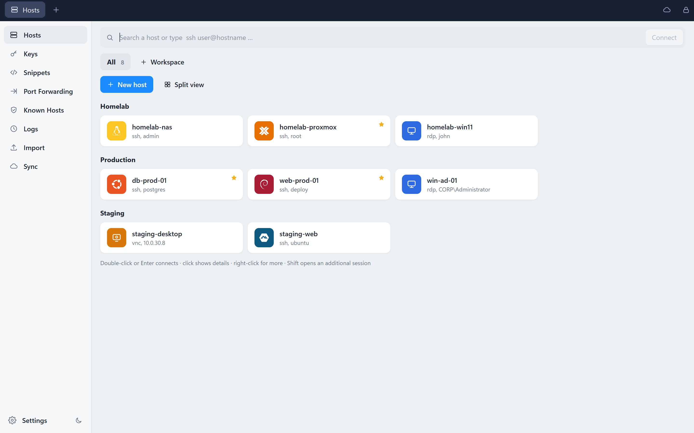
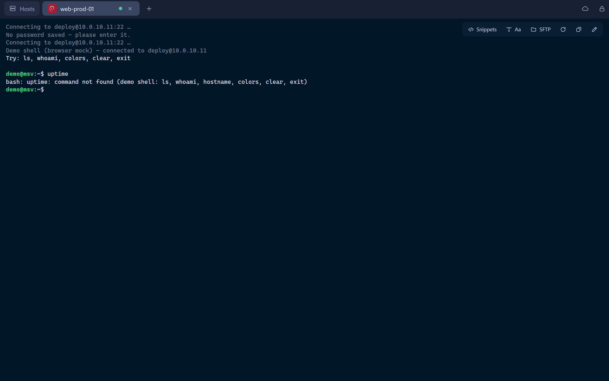
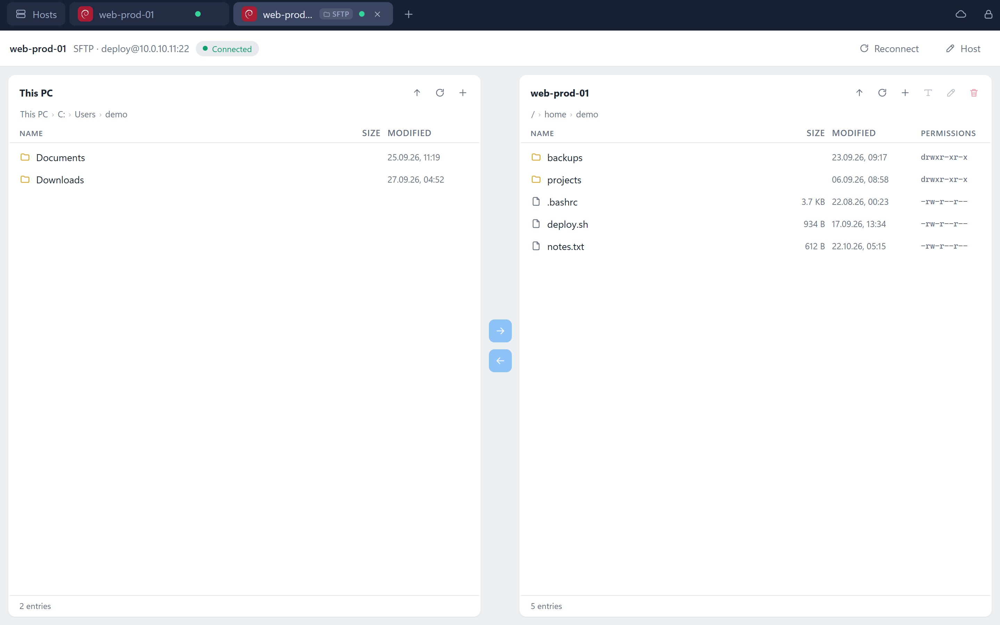
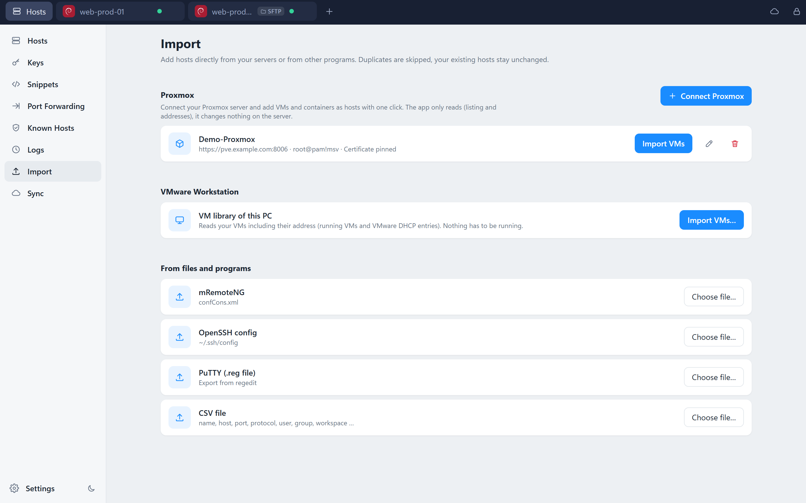
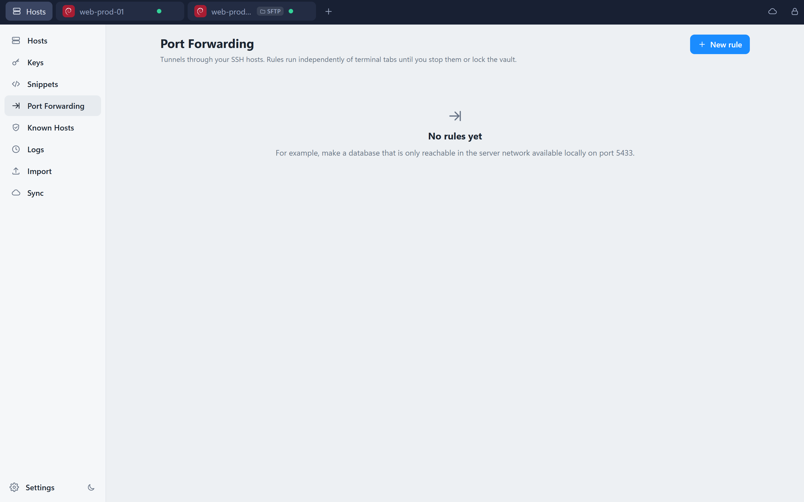
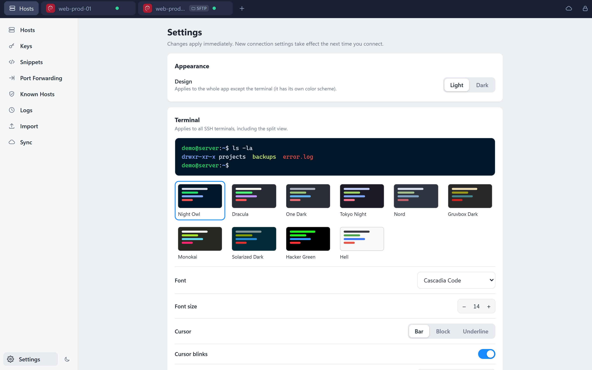

# MultiServerView

**One window for all your servers.** SSH, SFTP, RDP and VNC in tabs, a fast host switcher, workspaces to keep hundreds of hosts tidy, and an end-to-end encrypted vault that syncs between your PCs. For Windows, open source (MIT).

<table>
  <tr>
    <td><a href="docs/screenshots/hosts.png"></a></td>
    <td><a href="docs/screenshots/terminal.png"></a></td>
    <td><a href="docs/screenshots/sftp.png"></a></td>
  </tr>
  <tr>
    <td align="center">Hosts and workspaces</td>
    <td align="center">SSH terminal</td>
    <td align="center">SFTP</td>
  </tr>
  <tr>
    <td><a href="docs/screenshots/import.png"></a></td>
    <td><a href="docs/screenshots/forwards.png"></a></td>
    <td><a href="docs/screenshots/settings.png"></a></td>
  </tr>
  <tr>
    <td align="center">Import</td>
    <td align="center">Port forwarding</td>
    <td align="center">Settings</td>
  </tr>
</table>

## Features

### Connect
- **SSH terminal** – real terminal (xterm.js), password or key login, host key verification (trust on first use), 10 color schemes, fonts, a password prompt on failed logins just like PuTTY.
- **SFTP** – two panes (this PC / server), drag & drop, whole folders with progress and cancel, rename, delete, **edit remote text files** in place (with a "changed on the server" safety check).
- **RDP** – the native Windows RDP control (the same as mstsc / mRemoteNG) right inside a tab.
- **VNC** – noVNC in a tab, including Ctrl+Alt+Del and clipboard.
- **TeamViewer** – save a partner ID (and password) as a host and start the installed TeamViewer client with one click.
- **Jump hosts** – chain one or more SSH hosts for SSH, SFTP, tunnels, VNC and RDP.
- **Port forwarding** – local (-L), remote (-R) and SOCKS5 (-D), start/stop with one click.
- **Split view** – several terminals side by side in one tab, with broadcast (type once, send to all).

### Organize
- **Workspaces** – one section per customer, teacher, project or lab, so you never stare at hundreds of hosts at once.
- **Quick switcher** – `Ctrl+K`, a search bar that also understands `ssh user@host`, tabs, favorites, groups, OS logos, light and dark theme.
- **Identities, keys and snippets** – reuse credentials across hosts, generate SSH keys and install the public key on a server with one click, snippets with `{{variables}}` that ask for values when you run them.
- **Known hosts and history** – review and reset stored host keys, see your connection history (local only, no passwords).

### Import
Bring your servers with you. Duplicates are skipped, existing hosts stay untouched.
- **Proxmox VE** – connect with a read-only API token (certificate pinning included) and add VMs and containers as hosts, with their IPs and operating systems. Choose whether Proxmox pools become workspaces or groups. Delete everything an import added again with one click.
- **VMware Workstation** – reads your VM library, including addresses from running VMs and the VMware DHCP leases.
- **mRemoteNG**, **OpenSSH config** (`~/.ssh/config`), **PuTTY** (directly from Windows or a `.reg` file) and **CSV**.

### Let AI work on your servers
An optional **MCP server** (off by default) lets AI tools such as Claude Code list your hosts, run commands and read, write and list files over SSH/SFTP. Enable it in *Settings → AI tools*, copy the ready-made `claude mcp add …` command and you are done. It listens on `127.0.0.1` only and needs the token shown there; anything that has the token can act on your hosts while the vault is unlocked, so only enable it when you want that.

### Protect and sync
- **Encrypted vault** – PBKDF2-SHA256 (600,000 iterations) → AES-256-GCM. Passwords and private keys are never stored in plain text.
- **Sync between PCs** – through a **shared folder** (OneDrive, iCloud Drive, Dropbox, Syncthing …), a **WebDAV** server (Nextcloud, NAS, …) or your own free **Supabase** project. The server only ever sees the encrypted blob. Changes made on two PCs are merged per entry, conflict copies of folder services are picked up automatically.
- **Clear vault** – wipe everything with three confirmation steps. Change the master password, set an auto-lock, back up the vault.

## Download and install

Get the latest version from the **[Releases page](https://github.com/jxhnch/MultiServerView/releases)**:

| File | For |
|---|---|
| `MultiServerView-Setup-x.y.z.exe` | Installer wizard (no admin rights needed, Start menu entry, uninstaller). Updates itself: the app checks GitHub for a newer release at startup and installs it on request (switch off in *Settings → About*) |
| `MultiServerView-x.y.z-portable-win-x64.zip` | Portable: unpack anywhere and run `MultiServerView.exe` |

Nothing else has to be installed: .NET is bundled and the WebView2 runtime is part of Windows 10/11.

> **"Windows protected your PC" (SmartScreen)?** The downloads are not code-signed yet. Code-signing certificates cost money and are tied to a verified identity, and SmartScreen also distrusts every new, little-downloaded program. It does not mean the file is malware. Click **More info → Run anyway**. To be sure you have the original, download only from this repository's Releases page; the whole source and the build workflow (`.github/workflows/release.yml`) are public, so you can build it yourself as well.

On first start you create a **master password** (at least 8 characters). There is no recovery: if you forget it, nobody can open your vault.

## Where your data lives and how to start from zero

Uninstalling the app does **not** delete your data (so updates and reinstalls never lose your vault):

| What | Location |
|---|---|
| Vault, sync settings, connection history, settings | `%APPDATA%\MultiServerView` (`vault.msv`, `sync.json`, `history.json`, ...) |
| Interface settings (theme, terminal look) | `%LOCALAPPDATA%\MultiServerView\webview` |
| Your sync file in the shared folder | wherever you chose it (e.g. OneDrive), never touched by the app's uninstaller |

To start completely from scratch (**this permanently deletes your vault, there is no recovery**):

1. Optional: make a backup in *Settings* first.
2. Close MultiServerView and uninstall it (or just close it if you keep it).
3. Delete both folders:

```bash
rmdir /s /q "%APPDATA%\MultiServerView"
rmdir /s /q "%LOCALAPPDATA%\MultiServerView"
```

4. Delete the vault file in your sync folder as well (look for `MultiServerView-Vault.msv`), otherwise a new install can load it again. Then reinstall and create a new master password.

Portable ZIP: the same applies. If you only want to wipe the vault, use *Settings → Clear vault* inside the app (it empties the vault but keeps your master password).

## Keyboard shortcuts

In a terminal, plain Ctrl combinations belong to the shell, so app commands use `Ctrl+Shift`:

| Key | Action |
|---|---|
| `Ctrl+K` | Quick connect (outside the terminal) |
| `Ctrl+Shift+K` | Quick connect (**everywhere**, also inside a terminal) |
| `Ctrl+Tab` / `Ctrl+Shift+Tab` | Next / previous tab |
| `Ctrl+1 … 9` | Jump to a tab (1 = Hosts) |
| `Ctrl+Shift+W` | Close tab (middle click works too) |
| `Ctrl+Shift+N` | New host |
| `Ctrl+Shift+D` | Second session to the same host |
| `Shift+Enter` / `Shift+click` | Always open a new session when connecting |
| `Ctrl+Shift+C` / `Ctrl+Shift+V` | Terminal: copy / paste (right click works too) |

When the focus is inside an **RDP session**, all keys go to the remote PC (as in every RDP client). Click another tab with the mouse to leave it.

## Set up sync

**Shared folder (easiest):** open **Sync**, choose a folder that your folder service already syncs (for example in OneDrive) and connect. On the second PC choose *"New device? Load vault from a sync folder or cloud"* on the unlock screen, pick the same folder and unlock with the **same master password**.

**WebDAV (Nextcloud, Synology and other NAS, nginx/Apache, many hosters):** create a folder on the server, open **Sync**, choose WebDAV, enter the folder address (https://), user name and password (use an app password where offered). Conflicts are detected with the ETag, so devices never overwrite each other. On the second PC choose the same folder under *"New device? Load vault …"*.

**Supabase (about 3 minutes):**
1. Create a free project on [supabase.com](https://supabase.com).
2. **SQL Editor** → paste [`docs/supabase.sql`](docs/supabase.sql) → *Run*.
3. **Project Settings → API**: copy the *Project URL* and the *anon public* key.
4. In the app open **Sync**, choose Supabase, enter URL, key, e-mail and a cloud password → *Create account* → *Connect*. (If Supabase asks for a confirmation e-mail, confirm it first, or switch off "Confirm email" under *Authentication → Providers → Email*.)

After that, sync runs automatically about 3 seconds after every change and after unlocking. The cloud password is protected locally with Windows DPAPI. The master password never leaves your PC.

## Security in short

- Vault file: `%APPDATA%\MultiServerView\vault.msv`, encrypted with a key derived from your master password.
- Private SSH keys are never sent back to the UI after import; connections run entirely in the host process.
- SSH host keys use trust on first use. If the key of a known host changes, the connection is **refused** (you can reset the key in the host dialog).
- VNC runs through a local bridge that only listens on `127.0.0.1` and protects every connection with a one-time token.
- The browser development mode (`npm run dev`) stores demo data unencrypted and is only meant for UI development.

## Build from source

Requirements: [.NET 8 SDK](https://dotnet.microsoft.com/download/dotnet/8.0) and [Node.js 20+](https://nodejs.org).

```bash
scripts\publish.cmd          # runs tests, builds the UI, publishes to publish\MultiServerView.exe
```

For quick experiments:

```bash
cd ui && npm install && npm run build
dotnet run --project src/MultiServerView.App
```

> `dotnet publish` does not rebuild the UI. Always run `npm run build` in `ui/` first.

Develop the UI in the browser with demo data and a demo shell:

```bash
cd ui && npm install && npm run dev
```

Or against the real window with hot reload:

```bash
set MSV_DEV_URL=http://localhost:5173
dotnet run --project src/MultiServerView.App
```

Run the tests (also works on Linux/macOS):

```bash
dotnet test tests/MultiServerView.Core.Tests
```

SSH/SFTP/tunnel integration tests only run when `MSV_SSH_TEST_DIR` points to a folder with test keys and a local sshd listens on `127.0.0.1:2222` (user `msvtest`); otherwise they do nothing.

### Project layout

| Folder | Contents |
|---|---|
| `src/MultiServerView.Core` | Vault + crypto, merge and sync, SSH/SFTP/tunnels (SSH.NET), VNC bridge, importers (net8.0, platform independent) |
| `src/MultiServerView.App` | WinForms window with WebView2, bridge to the UI, RDP hosting, DPAPI, auto-sync, self-test |
| `ui/` | React + TypeScript (Vite): interface, xterm.js, noVNC |
| `tests/` | xUnit tests (crypto, vault, merge, sync against a simulated Supabase API and folders, VNC bridge, importers, SSH against a real sshd) |
| `installer/` | Inno Setup script for the installer wizard |
| `docs/` | Supabase SQL, comparison with Termius, first-run checklist, screenshots |

## Known limitations

- While a palette or dialog is open, a running RDP window is hidden briefly (the native window would otherwise cover the UI). The session keeps running.
- Convert PuTTY keys (`.ppk`) to OpenSSH format in PuTTYgen first.
- Import of saved passwords: mRemoteNG (decrypted with its master password, default or custom) and CSV; keys via `IdentityFile` of an OpenSSH config. PuTTY sessions and Proxmox/VMware have no readable passwords, and PuTTY `.ppk` keys must be converted to OpenSSH format first. There is no Termius import.
- No Telnet/Serial/Mosh, no AI autocomplete, no teams. See the [comparison with Termius](docs/comparison-with-termius.md).
- Windows only.

## License

[MIT](LICENSE). Contributions are welcome: open an issue or a pull request.

## Inspiration and vibe coding

MultiServerView is inspired by [Termius](https://termius.com), whose workflow (one place for hosts, terminal, SFTP and synced vault) I wanted on Windows with RDP and VNC included and under my own control. It is an independent project and not affiliated with Termius.

This project is **vibe-coded**: it was built together with an AI coding assistant (Claude Code). I steer the design and test the result, the assistant writes most of the code. The code is tested and the self-test runs on every build, but please review it yourself before trusting it with production credentials, and report anything that looks wrong.
