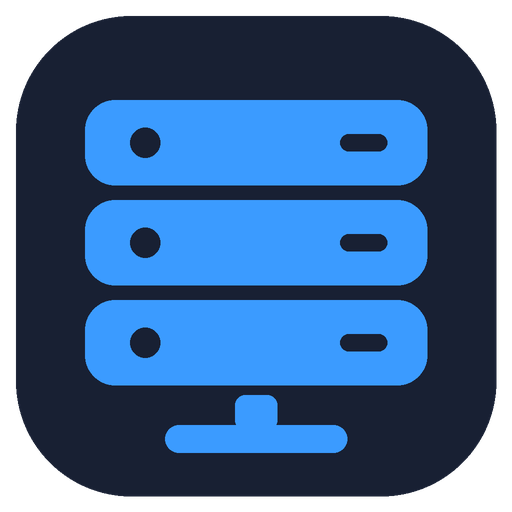
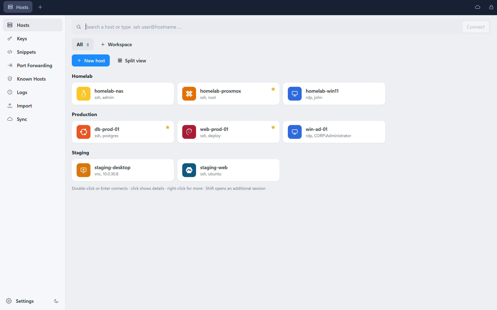
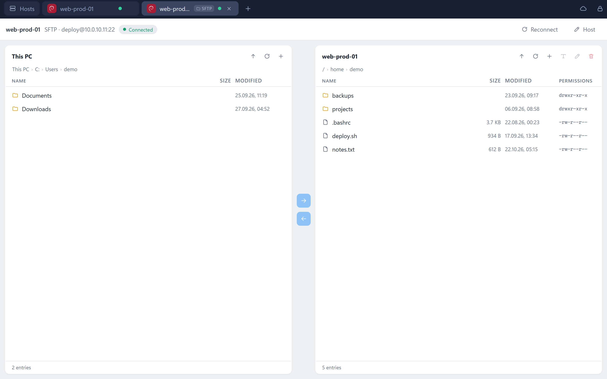
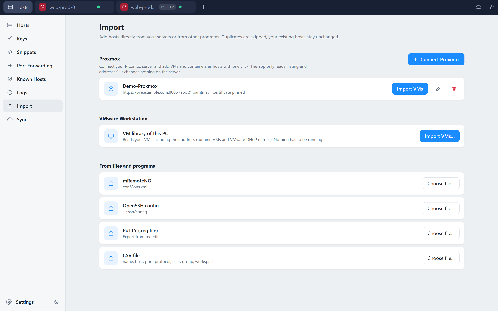
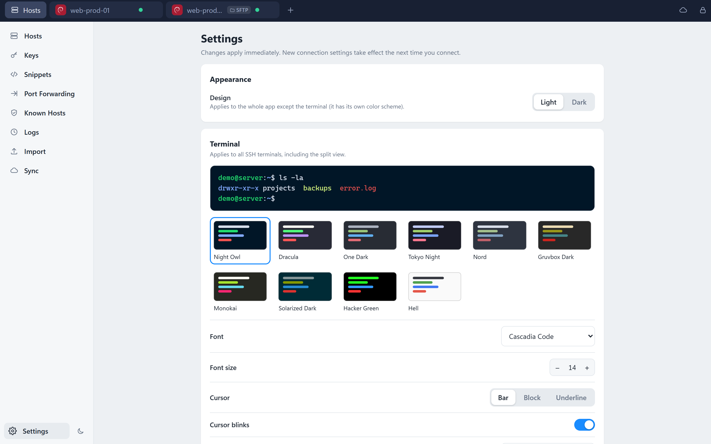

<p align="center">
  
</p>

<h1 align="center">MultiServerView</h1>

<p align="center">
  <strong>One window for all your servers.</strong><br>
  SSH, SFTP, RDP, VNC and more in tabs, with an encrypted vault that you decide where to keep.
</p>

<p align="center">
  <a href="https://github.com/jxhnch/MultiServerView/releases/latest"></a>
  <a href="https://github.com/jxhnch/MultiServerView/releases"></a>
  
  <a href="LICENSE"></a>
</p>

<p align="center">
  <a href="https://github.com/jxhnch/MultiServerView/releases/latest"><b>Download</b></a> ·
  <a href="#features">Features</a> ·
  <a href="#your-servers-in-any-terminal">msv</a> ·
  <a href="#ai-tools-optional">AI tools</a> ·
  <a href="#vault-and-security">Security</a> ·
  <a href="#documentation">Docs</a>
</p>

<p align="center">
  <a href="docs/screenshots/hosts.png"></a>
</p>

<table>
  <tr>
    <td width="33%"><a href="docs/screenshots/sftp.png"></a></td>
    <td width="33%"><a href="docs/screenshots/import.png"></a></td>
    <td width="33%"><a href="docs/screenshots/settings.png"></a></td>
  </tr>
  <tr>
    <td align="center">Two-pane SFTP</td>
    <td align="center">Import</td>
    <td align="center">Terminal themes</td>
  </tr>
</table>

MultiServerView is a desktop app for people who jump between many machines: homelab, customers, school, work. Hosts are sorted into workspaces, every connection opens in a tab, and your logins stay in an encrypted vault. It is free to use and source-available (not open source).

## Features

### Connect

| | |
|---|---|
| **SSH** | xterm.js terminal, password or key login, host key check, 10 color schemes |
| **SFTP** | Two panes, drag & drop, WinSCP-style F-keys, folder compare, edit remote files in your own editor |
| **RDP** | Inside a tab. Windows uses the same native control as `mstsc` |
| **VNC** | noVNC with clipboard and Ctrl+Alt+Del |
| **Telnet and serial** | For switches, routers and consoles (`COM3`, `/dev/ttyUSB0`) |
| **Web** | Open firewall, router, Proxmox or printer pages in a tab, with the saved login filled in |
| **WinRM** | PowerShell on Windows servers without SSH *(experimental)* |
| **TeamViewer** | Save partner IDs as hosts and start the installed client |

### Work

- **Jump hosts**, chained if needed, for SSH, SFTP, tunnels, VNC, RDP and web pages
- **Port forwarding**: local (`-L`), remote (`-R`) and SOCKS5 (`-D`)
- **Split view** with several terminals in one tab, plus broadcast to type into all of them
- **VM power control** for hosts imported from Proxmox or VMware, with a status dot
- **Snippets** with `{{variables}}`, reusable identities, SSH key generator and one-click key install

### Organize

- **Workspaces** per customer, project or lab, so you never scroll through hundreds of hosts
- **Quick switcher** on `Ctrl+K`, which also understands `ssh user@host`
- Favorites, groups, OS logos, light and dark theme, known hosts and connection history

### Bring your hosts with you

Import from **Proxmox VE**, **VMware Workstation**, **mRemoteNG**, **OpenSSH config**, **PuTTY** and **CSV**. Duplicates are skipped and existing hosts are not changed.

Everything in detail: **[Features](docs/features.md)** · **[Keyboard shortcuts](docs/shortcuts.md)**

## Your servers in any terminal

`msv` reads the same vault from PowerShell, cmd or bash, for SSH, Telnet and serial hosts.

```bash
msv          # pick a server from a list, type to filter
msv web      # connect to "web" right away, or pick from the matches
msv list     # print all servers
```

It asks for your master password and never writes to the vault, so you can use it while the app is open. [Setup](docs/features.md#msv-command-line)

## AI tools (optional)

A built-in **MCP server** lets Claude Code, Codex, Cursor, VS Code Copilot, Antigravity, Claude Desktop and other MCP clients work with your servers: run commands, manage files, use interactive terminals, control VMs and more.

- **Off by default**, listens on `127.0.0.1` only and requires a token
- Saved passwords and private keys are never shown to the AI
- **Read-only mode** and a limit to selected workspaces are available

> [!WARNING]
> Without those limits, anything that has the token has wide access to your servers, and to files on this PC, while the vault is unlocked. Read [what the AI can do](docs/ai-tools.md) before you switch it on.

## Download

Get the latest build from the **[Releases page](https://github.com/jxhnch/MultiServerView/releases/latest)**.

| System | File |
|---|---|
| **Windows**, installer | `MultiServerView-Setup-<version>.exe` (no admin rights needed, updates itself on request) |
| **Windows**, portable | `MultiServerView-<version>-portable-win-x64.zip` |
| **Debian / Ubuntu** | `.deb` |
| **Fedora / RHEL-based** | `.rpm` |
| **Other Linux** | `.AppImage` or `.tar.gz` |
| **Arch-based** | [`PKGBUILD`](packaging/linux/PKGBUILD) |

On first start you create a master password.

> [!IMPORTANT]
> **There is no password recovery.** If you forget the master password, nobody can open your vault.

> [!NOTE]
> **Windows shows "Windows protected your PC"?** The files are not code-signed yet. Download only from this repository, then click **More info → Run anyway**. [Why this happens](docs/install.md#smartscreen-warning)

Linux packages, dependencies and uninstalling: **[Installation guide](docs/install.md)**

## Vault and security

Your vault is encrypted with **AES-256-GCM**, using a key derived from your master password (**PBKDF2-SHA256, 600,000 iterations**). It is encrypted before it leaves your PC.

You choose where it lives:

| Place | What you need |
|---|---|
| **This PC** | Nothing, this is the default |
| **A folder** | A folder synced by OneDrive, iCloud, Dropbox or Nextcloud |
| **GitHub** | A private gist and a token with the `gist` permission |
| **Supabase** | Your own free project |

SSH host keys are trusted on first use. If a known key changes, the connection is refused. More in **[Vault and security](docs/vault.md)**.

## Documentation

| Page | Contents |
|---|---|
| [Features](docs/features.md) | Every feature in detail, import limits, `msv` |
| [AI tools](docs/ai-tools.md) | MCP setup, permissions and limits |
| [Vault and security](docs/vault.md) | Vault sources, conflicts, data locations, full reset |
| [Installation](docs/install.md) | Windows and Linux |
| [Keyboard shortcuts](docs/shortcuts.md) | All shortcuts |
| [Development](docs/development.md) | Build, test, project layout |
| [Comparison with Termius](docs/comparison-with-termius.md) | What is there and what is missing |

## Known limitations

- No Mosh, no local terminal tab, no AI autocomplete, no team features
- PuTTY keys (`.ppk`) must first be converted to OpenSSH format in PuTTYgen
- There is no Termius import
- Windows: a running RDP window is briefly hidden while a menu, palette or dialog is open. The session keeps running

## How this project is built

MultiServerView is **vibe-coded**: I built it together with an AI coding assistant (Claude Code). I steer the design and test the result, the assistant writes most of the code. The code has tests and the builds run a self-test, but **please review it yourself before trusting it with production credentials**, and report anything that looks wrong.

It is inspired by [Termius](https://termius.com): one place for hosts, terminal, SFTP and a vault that is available everywhere. I wanted that workflow on Windows, with RDP and VNC included and under my own control. This is an independent project and not affiliated with Termius.

## License

[MultiServerView Source-Available License](LICENSE): free to use, including commercial use inside your own organization. Redistribution and independent forks are not allowed. Contributions are welcome through issues and pull requests.
